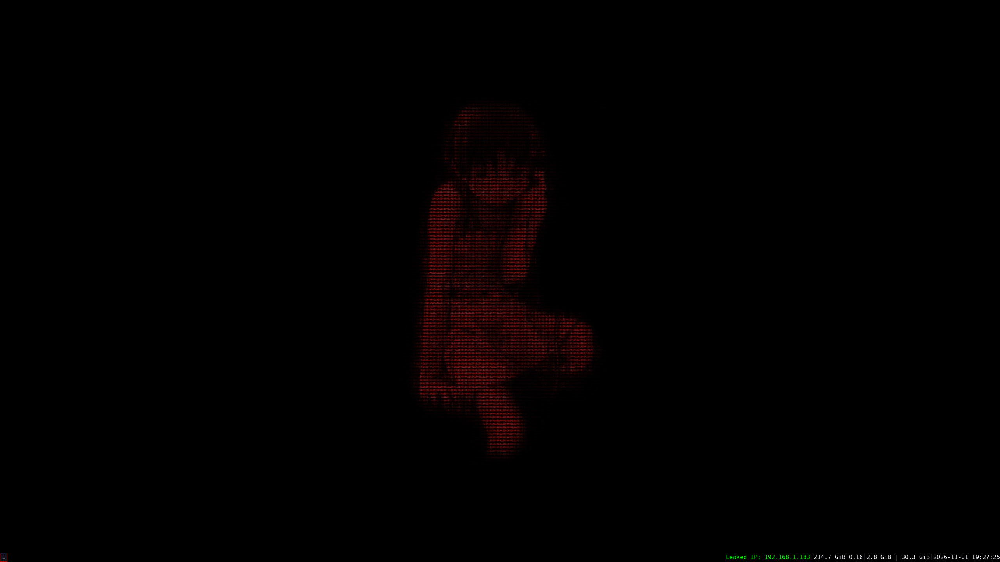

# Serial Experiments Lain Dotfiles (BSD) 


## Project Structure
```
bsd-dot-lain/
├── .config/
├── LICENSE
├── README.md
├── freebsd_install.sh
└── openbsd_install.sh
```

# Preview 

<div align="center">

</div>

## Requirements

This setup is intended for:

- BSD Operating System
- A fresh or minimal installation
- An active internet connection
- A user account with `doas` privileges

## Included Packages

The installation script installs the following tools:

- `i3` — lightweight window manager
- `i3status` — system information bar for i3
- `alacritty` — terminal emulator
- `tmux` - terminal multiplexer
- `git` — version control system
- `feh` — image viewer and wallpaper setter
- `dmenu` — application launcher

## Installation

Clone this repository:

```bash
git clone https://github.com/milkinit/bsd-dot-lain.git && cd bsd-dot-lain
```
